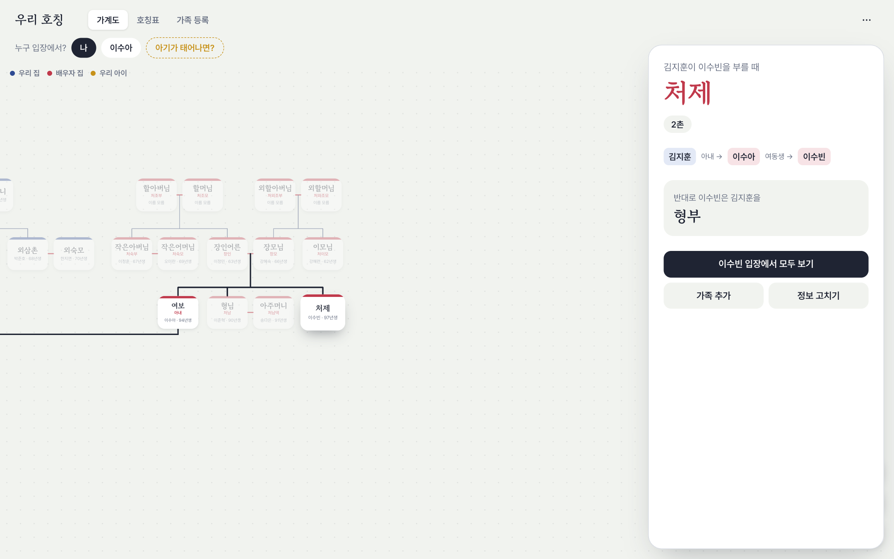
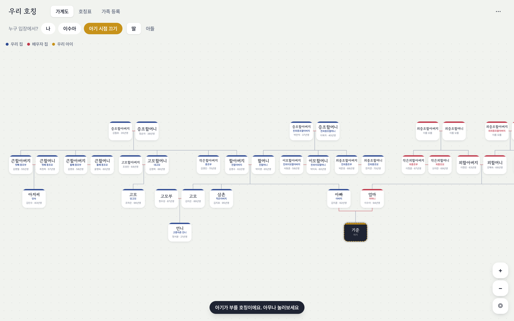
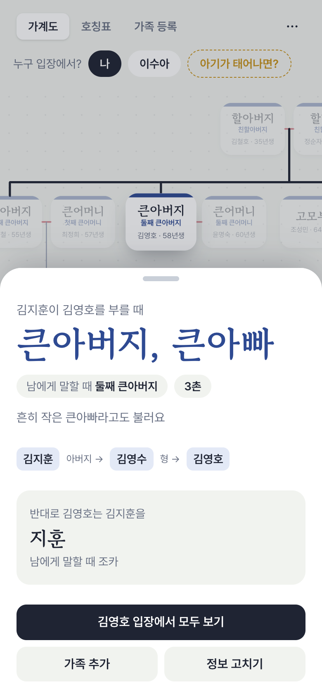

# 우리 호칭

> 결혼하고 나서 헷갈리는 호칭, 가계도 한 장으로 정리해요.

**바로 쓰기: <https://cooperkang.github.io/family-tree/>**

아내의 동생은 처제일까요, 처형일까요? 아버지의 둘째 형은 뭐라고 불러야 할까요? 아기가 태어나면 엄마의 오빠를 뭐라고 부르게 해야 할까요?

내 가족과 배우자 가족을 등록하면 양가가 하나의 가계도로 이어집니다. 사람을 누르면 그 사람을 부를 때 쓰는 말(호칭), 남에게 말할 때 쓰는 말(지칭), 촌수, 그리고 그 사람이 나를 부르는 말까지 한 번에 보여줘요.



## 할 수 있는 것

- **양가 가계도**: 우리 집은 청색으로 왼쪽, 배우자 집은 홍색으로 오른쪽에 펼쳐지고, 두 집안은 결혼으로 이어져요. 끌어서 옮기고 두 손가락으로 확대할 수 있어요.
- **누구 입장에서든**: 기준을 나, 배우자, 아기, 큰아버지 등 누구로 바꾸든 모든 이름표가 그 사람 입장의 호칭으로 뒤집혀요.
- **관계 풀이**: 사람을 누르면 "김지훈 → 아내 → 여동생" 같은 경로가 그려지고, 반대로 부르는 말도 함께 나와요.
- **아기가 태어나면?**: 아직 아기가 없어도 미리 아기 입장에서 할아버지, 외삼촌, 이모할머니 같은 호칭을 볼 수 있어요. 딸/아들을 바꿔 볼 수 있어요.
- **호칭표**: 한 사람이 모두를 뭐라고 부르는지 표 한 장으로 볼 수 있어요.
- **가족 등록**: "+ 아내 동생", "+ 아버지의 형제" 같은 버튼으로 추가하고, 입력하는 동안 "나에게는 처제"처럼 관계가 미리 보여요.

| 아기 입장에서 보기 | 휴대폰 |
|---|---|
|  |  |

## 호칭은 이렇게 정해요

두 사람 사이의 가장 짧은 관계 경로(예: `아내 → 여동생`)를 구한 뒤 호칭 사전에서 찾아요.

- **가족·친척**: 처가와 시댁, 형제의 배우자, 부모와 조부모의 형제, 사돈, 조카·손주까지 사전에 들어 있어요.
- **사촌과 그 주변**: 친사촌·고종·외사촌·이종을 구분하고, 출생년도로 나이를 비교해 "사촌 형"인지 "사촌 동생"인지 정해요. 배우자의 사촌, 부모의 사촌(당숙·당고모), 오촌 조카는 규칙으로 처리해요.
- **같은 자리에 여러 명**: "첫째 큰아버지", "둘째 큰아버지"처럼 순서를 붙이고, "흔히 작은 큰아빠라고도 불러요" 같은 안내도 같이 보여줘요.
- **결혼 여부**: 결혼 전후로 삼촌 → 작은아버지, 도련님 → 서방님처럼 호칭을 바꿔요.
- **딱 맞는 말이 없을 때**: 사돈의 가족처럼 정해진 호칭이 없으면 "사돈 / 사돈어른"으로 보여주고, 관계를 풀어서 함께 설명해요.

호칭은 지역과 집안마다 조금씩 다를 수 있어요. 틀리거나 빠진 호칭을 발견하면 [이슈](https://github.com/CooperKang/family-tree/issues)로 알려 주세요.

## 개인정보

가족 정보는 **지금 쓰는 브라우저에만** 저장되고, 어떤 서버로도 보내지 않아요. 다른 기기에서 이어 보려면 메뉴(⋯)의 "파일로 저장하기"와 "불러오기"를 쓰세요. 브라우저 데이터를 지우면 가계도도 함께 지워지니 파일로 저장해 두는 걸 권해요.

- 휴대폰에서는 공유 창이 열려 "파일에 저장"하거나 메신저로 보낼 수 있어요.
- 카카오톡·네이버 앱 같은 앱 안 브라우저는 파일 저장을 막는 경우가 많아요. 이때는 "가계도 내용 복사하기"로 복사한 뒤 Safari나 Chrome의 "불러오기"에 붙여넣으면 옮겨져요.

## 직접 실행하기

Node.js 22 이상이 필요해요.

```bash
git clone https://github.com/CooperKang/family-tree.git
cd family-tree
npm install
npm run dev      # http://localhost:5173
npm test         # 호칭 사전·가계도 배치 테스트
npm run build    # dist/ 에 배포용 파일 생성
```

`main` 브랜치에 올리면 GitHub Actions가 테스트하고 빌드한 뒤 GitHub Pages에 배포해요(`.github/workflows/deploy.yml`).

## 구조

```
src/
  kin/            호칭 엔진 (화면과 무관한 순수 로직, 테스트 포함)
    graph.ts      관계 그래프: 최단 관계 경로, 나이 비교, 촌수, 세대
    terms.ts      경로 → 호칭/지칭 사전과 사촌·사돈 규칙
    layout.ts     가계도 배치: 세대별 줄, 부부 묶음, 양가 좌우 배치
    ops.ts        가족 추가·수정·삭제
    sample.ts     예시 가족
  components/     화면 (시작, 가계도, 관계 패널, 호칭표, 가족 등록)
  store.ts        브라우저 저장, 아기 미리보기
```

React · TypeScript · Vite · Tailwind CSS · Motion · react-zoom-pan-pinch로 만들었어요.

## 만든 사람

**JaeHa Kang** · [GitHub @CooperKang](https://github.com/CooperKang)

다른 서비스는 [cooperkang.github.io](https://cooperkang.github.io/)에 모여 있어요.

## 라이선스

[MIT](LICENSE) © 2026 JaeHa Kang
